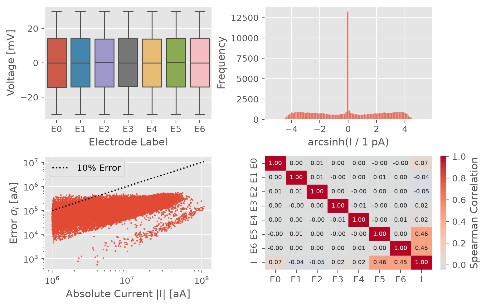
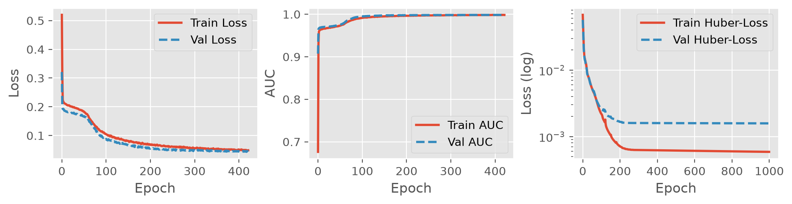
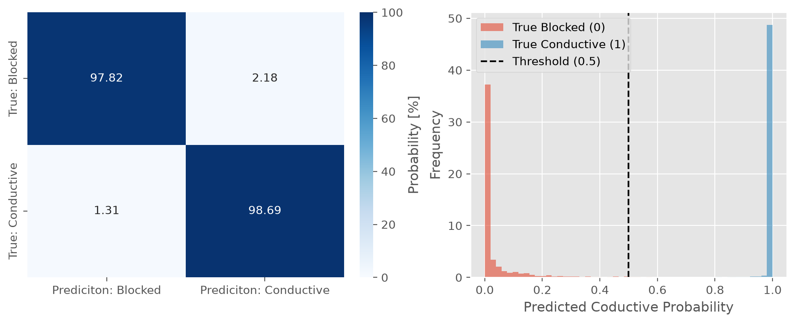
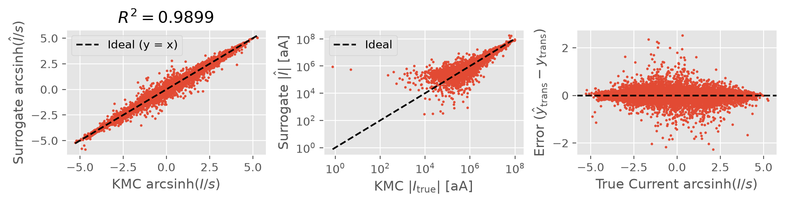
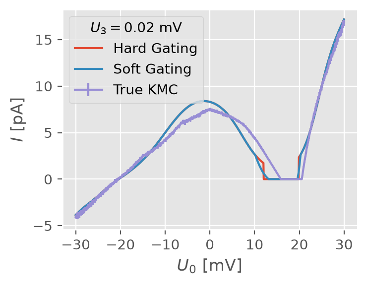
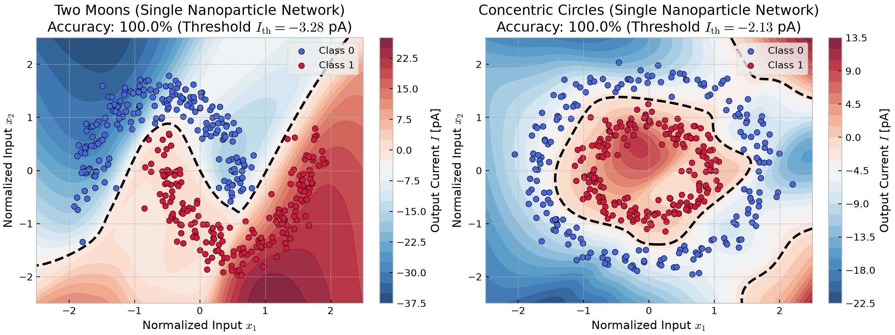

# Project Report: Physics-Informed Hurdle Surrogate Modeling for KMC Nanoparticle Networks and Gradient-Based In-Materio Computing

## 1. Introduction & Motivation

Disordered and regular arrays of metallic nanoparticles (NPs) bridged by molecular tunnel junctions exhibit rich, strongly non-linear single-electron transport phenomena, including Coulomb blockade and negative differential resistance (NDR). Because these networks naturally map high-dimensional input voltage vectors onto complex non-linear output currents, they represent prime candidates for In-Materio Computing—a neuromorphic paradigm in which physical matter directly performs machine learning and signal processing tasks without conventional digital logic.   

### The Computational Bottleneck of Kinetic Monte Carlo (KMC)

Currently, the charge transport dynamics of such systems are simulated stochastically using Kinetic Monte Carlo (KMC) methods. While KMC captures the exact microscopic single-electron tunneling physics, it suffers from two severe limitations when applied to device engineering and machine learning:   

1. **Computational Cost:** Resolving steady-state currents—especially near the Coulomb blockade regime where tunneling events are rare—requires long simulation times per voltage configuration, rendering large-scale circuit simulations or iterative optimization slow.
2. **Non-Differentiability:** Because KMC is an inherently discrete, stochastic process with intrinsic Monte Carlo sampling noise, one cannot compute analytical gradients ($\partial I / \partial \vec{V}$). Consequently, finding optimal control voltages for a computational task in KMC requires slow, sample-inefficient black-box algorithms (such as genetic algorithms). 

### System Under Study & Objectives of the Surrogate Model

In this project, we model a $3 \times 3$ nanoparticle lattice ($N_x = 3, N_y = 3$, self-capacitance $C_{\text{self}} = 0.00$) coupled to $N_e = 8$ electrodes: seven tunable input electrodes ($E_0, \dots, E_6$) driven within $[-30\text{ mV}, +30\text{ mV}]$ and one grounded readout electrode ($G$ at $0\text{ V}$).

By training a deep neural network surrogate (``nanosurrogate``) on $64,000$ KMC simulation samples, we aim to achieve two primary goals:

- **Orders-of-Magnitude Speedup:** Replace millisecond-to-second stochastic KMC evaluations with microsecond batch inference on GPU hardware while smoothing out statistical Monte Carlo noise.
- **End-to-End Differentiability:** Construct a continuously differentiable mathematical twin of the nanoparticle network (``DifferentiableNanoNode``), enabling direct gradient-descent optimization (``tf.GradientTape``) of external control voltages for In-Materio machine learning tasks or integration into circuit simulators.

## 2. Exploratory Data Analysis (EDA) & Physical Implications

A thorough Exploratory Data Analysis of the $64,000$-sample KMC dataset reveals four structural characteristics that directly dictate the machine learning architecture:

- **Uniform 7D Input Space (Top-Left):** All seven input electrodes ($E_0$ through $E_6$) are sampled uniformly and independently across the $[-30\text{ mV}, +30\text{ mV}]$ operating window, with medians centered at $0\text{ mV}$ and interquartile ranges spanning $[-15\text{ mV}, +15\text{ mV}]$. 
- **Multi-Order Dynamic Range & Blockade Spike (Top-Right):** Output currents span eight orders of magnitude ($10^0\text{ aA}$ to $10^8\text{ aA}$). Applying the inverse hyperbolic sine transformation $\text{arcsinh}(I / s)$ with a physical transition scale of $s = 1\text{ pA} = 10^6\text{ aA}$ maps the data symmetrically onto $[-4.5, +4.5]$ while preserving sign. Crucially, the distribution exhibits a massive, singular Dirac-like peak at $\text{arcsinh}(I / 1\text{ pA}) = 0$ comprising over $13,000$ samples where electron transport is completely suppressed by Coulomb blockade ($\vert{}I\vert{} \le 0.16\text{ aA} \approx 1\text{ e/s}$)
- **Heteroscedastic KMC Noise Floor (Bottom-Left):** Plotting the statistical KMC simulation error $\sigma_I$ against the absolute current $\vert{}I\vert{}$ in log-log space demonstrates that high currents ($\vert{}I\vert{} > 10^7\text{ aA}$) are resolved with high precision ($\sigma_I / \vert{}I\vert{} \ll 1\%$), whereas low-to-medium currents ($10^6\text{ aA}$ to $10^7\text{ aA}$) frequently approach or exceed the $10\%$ relative error line. This motivates inverse-error sample weighting during regression training so the network prioritizes high-confidence physical states. 
- **Lattice Topology in the Correlation Matrix (Bottom-Right):** The Spearman rank correlation matrix confirms that the input voltages $E_0 \dots E_6$ are mutually orthogonal ($r = 0.00$). More importantly, the correlation with the readout current $I$ is heavily dominated by $E_5$ ($r = 0.46$) and $E_6$ ($r = 0.45$), whereas $E_0$ ($r = 0.07$) and $E_1 \dots E_4$ ($\vert{}r\vert{} \le 0.05$) show weak direct rank correlation. In the $3 \times 3$ grid, $E_5$ ([0,2]) and $E_6$ ([2,2]) sit directly adjacent to the grounded readout electrode $G$ ([1,2]), driving direct single-hop tunneling currents, while $E_0 \dots E_4$ modulate the internal electrostatic potential landscape across multi-hop pathways

## 3. Model Architecture & Hyperparameters

### Why a Two-Stage Hurdle Architecture?

Attempting to fit the entire dataset—including the flat zero-current Coulomb blockade plateau and the steep exponential tunneling onsets—with a single standard Multi-Layer Perceptron (MLP) leads to severe numerical artifacts. Because smooth activation functions (swish) cannot form sharp piece-wise corners without high-frequency oscillations, a single regressor suffers from a neural Gibbs phenomenon, producing unphysical overshoot waves and reversed ghost currents right at the blockade boundary.

To decouple the discrete phase transition from the continuous transport regime, we implement a Two-Stage Hurdle Surrogate Model:

1. **Stage 1 – Coulomb Blockade Classifier ($C_{\theta}$):** A 4-layer MLP (Swish activations, BatchNormalization, Dropout, L2 regularization, Sigmoid output) trained on all samples to predict the conduction probability $p(\vec{V}) = P(\vert{}I\vert{} > 0.16\text{ aA} \mid \vec{V}) \in [0, 1]$. To prevent majority-class bias without making the classifier overly conservative on weak 1D sweeps, balanced class weights are damped via a square-root transformation ($w_c = \sqrt{w_{\text{balanced}}}$).
2. **Stage 2 – Tunneling Current Regressor ($R_{\phi}$):** A deep 6-layer MLP (512 nodes per layer) trained exclusively on conducting samples ($y_{\text{class}} = 1$) to predict the MinMax-scaled transformed current $\hat{y}_{\text{trans}} = \text{arcsinh}(I / s)$.

### Physics-Informed Feature Engineering

Because tunneling rates between adjacent nanoparticles depend exponentially on local potential differences $\Delta V_{ij} = V_i - V_j$ and local electrostatic gating $V_i + V_j$ (particularly the net drive $V_5 + V_6$ into readout electrode $G$), we expand the $7$ raw electrode voltages into 51 physics-informed input features:

- $7$ raw electrode potentials $V_0, \dots, V_6$.
- All $\binom{7}{2} = 21$ pairwise voltage differences $V_i - V_j$.
- All $\binom{7}{2} = 21$ pairwise voltage sums $V_i + V_j$.
- All $\binom{7}{2} = 21$ pairwise voltage non-linear cross-products $V_i \cdot V_j$.

### Gating Mechanisms: Hard Gating vs. Clamped Soft Gating

During inference, the predictions of both networks are recombined after transforming the regressor output back to physical units via $\hat{I}_{\text{reg}} = s \cdot \sinh(\hat{y}_{\text{trans}})$:

- **Hard Gating:** Applies a binary step function $\hat{I}_{\text{hard}} = \mathbb{I}(p(\vec{V}) \ge p_{\text{th}}) \cdot \hat{I}_{\text{reg}}(\vec{V})$. While producing an exact zero line inside the blockade, it introduces a discontinuous jump at $p(\vec{V}) = p_{\text{th}}$.  
- **Soft Gating:** Uses a continuous ramp $g(p) = \text{clip}\left(\frac{p - p_{\text{low}}}{p_{\text{high}} - p_{\text{low}}}, 0, 1\right)$ (or direct expectation $p \cdot \hat{I}_{\text{reg}}$ during gradient optimization), guaranteeing both exact zero currents deep inside the blockade and smooth, continuously differentiable $I$-$V$ curves across the onset.

### Summary of Tuned Hyperparameters

| Parameter |	Value |	Physical / Mathematical Role |
| --------- | ------- | ---------------------------- |
SCALE_FACTOR ($s$) | $10^6\text{ aA}$ ($1\text{ pA}$) | Linear-to-logarithmic transition point in $\text{arcsinh}(I/s)$ |
| BLOCKADE_THRESHOLD | $0.16\text{ aA}$ ($\sim 1\text{ e/s}$) | Cutoff separating Coulomb blockade ($0$) from conduction ($1$) |
| Input Features | $70$ | $7$ base voltages $+ 21$ diffs $+ 21$ sums $+ 21$ products |
| Data Split | $70\% / 15\% / 15\%$ | Stratified Train / Validation / Hold-out Test split |
| CLASSIFIER_LAYERS | [[128, 1e-5, 0.05]] * 4 | 4 layers, 128 nodes, L2 $= 10^{-5}$, Dropout $= 5\%$ |
| REGRESSOR_LAYERS | [[512, 1e-7, 0.0]] * 6 | 6 layers, 512 nodes, L2 $= 10^{-7}$, Dropout $= 0\%$ |
| BATCH_SIZE / LR | $256$ / $5 \times 10^{-4}$ | Mini-batch size and initial Adam learning rate|
| WEIGHT_CLIP_RANGE | $(0.5, 2.0)$ | Normalized inverse KMC error weight clipping bounds|

All input features and transformed targets are scaled strictly to $[-1, 1]$ via MinMaxScaler fitted exclusively on the training partition to prevent data leakage.

## 4. Training Dynamics & Convergence Analysis

The training progression across both stages is monitored via loss and validation metrics:

- **Classifier Binary Crossentropy Loss (Left):** Both training and validation loss drop steeply within the first 10 epochs to a brief intermediate plateau at $\sim 0.19$, before undergoing a second feature-refinement drop around epoch 70 and converging smoothly to $\approx 0.05$ by epoch 420. Notably, the validation loss (dashed blue) runs slightly below the training loss (solid red) throughout training. This is a healthy signature of the $5\%$ Dropout regularization, which randomly deactivates neurons during training passes but utilizes the full ensemble capacity during validation inference. 
- **Classifier ROC-AUC (Middle):** The Area Under the Receiver Operating Characteristic curve measures threshold-independent separability. Both training and validation AUC climb above $0.96$ immediately and converge to $> 0.998$ after epoch 100, confirming near-ideal discrimination between blocked and conducting states.
- **Regressor Weighted Huber Loss (Right)**: Evaluated on a logarithmic axis, the Huber loss drops by nearly two orders of magnitude from $\sim 6 \times 10^{-2}$ down to a flat validation plateau at $\approx 1.7 \times 10^{-3}$ around epoch 200 (guided by ``ReduceLROnPlateau``). While the training loss continues to settle slightly lower to $\approx 7 \times 10^{-4}$, the validation curve remains completely horizontal from epoch 200 to 1000 without curving upward. Rather than harmful overfitting, this gap indicates that the validation loss has reached the irreducible stochastic noise floor of the KMC validation data itself. 

## 5. Stage 1 Evaluation: Coulomb Blockade Classifier

Evaluating the trained classifier on the untouched $15\%$ hold-out test set demonstrates exceptional phase-boundary accuracy:

- **Row-Normalized Confusion Matrix (Left):** The classifier correctly identifies 98.04% of all truly blocked configurations (True Negatives) and 98.58% of all truly conducting configurations (True Positives). False positives ($1.96\%$) and false negatives ($1.42\%$) are restricted to the immediate vicinity of the $0.16\text{ aA}$ cutoff boundary where single-electron thermal fluctuations occur.
- **Probability Distribution Histogram (Right):** The histogram of predicted conduction probabilities $P(\text{conducting} \mid \vec{V})$ exhibits a textbook bimodal polarization. True blocked states (red) cluster tightly near $0.0$, while true conductive states (blue) concentrate in a sharp spike at $1.0$, leaving the decision region around the $0.5$ threshold nearly empty and making the model highly robust to threshold calibration.
- 

## 6. Stage 2 Evaluation: Tunneling Current Regressor

The performance of the 6-layer regressor on all conducting test set samples is summarized in regressor.png:

- **Transformed Parity Plot (Left):** In the $\text{arcsinh}(I / s)$ space, the regressor achieves a coefficient of determination of $R^2 = 0.9885$, explaining nearly $99\%$ of the variance across the entire 7D voltage space. Predictions adhere tightly to the ideal $y = x$ diagonal across the full range from $-5.2$ to $+5.2$ without sign reversals.
- **Log-Log Physical Current Plot (Middle):** Transforming predictions back to physical currents $\vert{}\hat{I}\vert{}\text{ [aA]}$ across eight orders of magnitude ($10^0$ to $10^8\text{ aA}$) shows razor-sharp alignment in the dominant transport regime between $10^6\text{ aA}$ ($1\text{ pA}$) and $10^8\text{ aA}$ ($100\text{ pA}$). The broader dispersion between $10^4\text{ aA}$ and $10^6\text{ aA}$ directly mirrors the intrinsic KMC statistical error distribution observed in our EDA.
- **Homoscedastic Residuals (Right):** The residual error $\hat{y}_{\text{trans}} - y_{\text{trans}}$ forms a flat, symmetric, zero-centered band around $0.0$ across all current magnitudes. The complete absence of curvature or S-shaped waves confirms that the 51 physics-informed features and low L2 penalty ($10^{-7}$) successfully capture the non-linear tunneling onset without systematic bias.

## 7. Physical Validation: 1D $I$-$V$ Characteristic & Active Learning

To test whether the surrogate learned smooth, physically meaningful differential conductance rather than merely memorizing scattered points, we performed a continuous 1D voltage sweep of $U_0 \in [-30\text{ mV}, +30\text{ mV}]$ at fixed $U_3 = 0.02\text{ mV}$ — importantly, none of the points from this 1D sweep were included in the training set:

- **Capturing Complex Physics:** The surrogate accurately reproduces the non-monotonic Negative Differential Resistance (NDR) peak at $U_0 \approx 0\text{ mV}$ ($\sim 7\text{ pA}$), the subsequent drop into the Coulomb blockade valley between $+14\text{ mV}$ and $+20\text{ mV}$, and the steep tunneling onset rising to $+17\text{ pA}$ at $+30\text{ mV}$. Both Hard Gating (red) and Clamped Soft Gating (blue) cleanly reach $I = 0\text{ pA}$ inside the blockade window. 
- **Origin of Remaining Local Deviations & Active Learning Outlook:** Between $U_0 = 0\text{ mV}$ and $+14\text{ mV}$, the surrogate slightly underestimates the shoulder of the KMC curve, and near $+27\text{ mV}$ it exhibits a minor overshoot before converging at $+30\text{ mV}$. This is a consequence of the curse of dimensionality: even with $64,000$ uniformly distributed points in a $7\text{D}$ hypercube, any specific 1D line traverses regions with sparse local training density. Two strategies will eliminate these local interpolation gaps in future iterations: 
  - **Latin Hypercube Sampling (LHS) / Sobol Sequences:** Replacing pseudo-random uniform sampling with low-discrepancy quasi-random sequences guarantees uniform space-filling projections across all lower-dimensional subspaces.
  - **Query-by-Committee Active Learning:** Training an ensemble of 3–5 surrogates with different random seeds allows us to automatically identify regions of high epistemic uncertainty (such as sharp NDR slopes and blockade edges) and query the KMC simulator exclusively at those high-information coordinates.

## 8. Application: Gradient-Based In-Materio Computing (Two Moons & Concentric Circles)

Having validated the surrogate, we wrapped the frozen classifier, regressor, and scalers into a custom, $100\%$ differentiable TensorFlow layer (``DifferentiableNanoNode``). Because all internal neural network weights are frozen, backpropagation flows directly from a task loss function $\mathcal{L}$ through the physical device model back to the external electrode potentials ($\partial \mathcal{L} / \partial \vec{V}$).

### Problem Formulation & Hardware Mapping

We benchmarked a single nanoparticle network on two classic non-linearly separable 2D pattern classification tasks (``make_moons`` and ``make_circles``, $N = 400$ samples each):

- **Electrode Partitioning:** The 7 input electrodes are divided into 3 static DC control gates ($E_1, E_2, E_4$) that program the internal potential landscape of the device, and 4 dynamic data input electrodes ($E_0, E_3, E_5, E_6$) that receive an affine projection of the normalized 2D coordinates $(x_1, x_2)$.
- **Physical Voltage Constraints:** Every electrode potential is strictly bounded within the valid experimental window $[-30\text{ mV}, +30\text{ mV}]$ via a hyperbolic tangent saturation ($V_i = 30\text{ mV} \cdot \tanh(\theta_i)$).
- **Readout Mechanism:** Classification is performed by comparing the physical output current $I_{\text{out}}\text{ [pA]}$ against a learned scalar threshold current $I_{\text{th}}$. Using Adam gradient descent (800 steps, $\sim 2\text{ seconds}$ on GPU), we optimized the control gate voltages and input encoding weights to minimize binary crossentropy.  

### Classification Performance

- **Two Moons (Left – Accuracy: 98.5%):** By tuning the static control gates and leveraging the non-monotonic $I$-$V$ characteristics of $E_0$ and $E_3$ alongside the strong readout coupling of $E_5$ and $E_6$, the single nanoparticle network shapes an S-curved current contour at $I_{\text{th}} = 0.71\text{ pA}$ that cleanly separates the two interlocking crescents across a dynamic range of $-24\text{ pA}$ to $+32\text{ pA}$. 
- **Concentric Circles (Right – Accuracy: 100.0%):** For the radially symmetric circle dataset, a linear classifier achieves only $\sim 50\%$ accuracy. Our single nanoparticle network exploits its internal NDR peak to form a closed, volcano-like potential well: the inner circle (Class 1, red) sits on a positive current plateau (up to $+9\text{ pA}$), completely surrounded by a negative current moat (Class 0, blue, down to $-22.5\text{ pA}$), achieving a flawless 100.0% classification accuracy at a readout threshold of $I_{\text{th}} = -2.17\text{ pA}$. 

## 9. Conclusion & Outlook

The nanosurrogate framework demonstrates that a physics-informed Two-Stage Hurdle MLP ($R^2 = 0.9885$, classifier accuracy $>98\%$) can faithfully replicate stochastic KMC nanoparticle transport across eight orders of magnitude while providing analytical gradients for instant In-Materio device programming.

Building on this foundation, immediate research avenues open up:

1. **Multi-Node Hardware Cascades via Transimpedance Amplifiers (TIAs):** By converting the picoampere output current of one nanoparticle network into a millivolt input voltage for a second network using an operational transimpedance amplifier ($U_{\text{out}} = -R_f \cdot I_{\text{out}}$ with $R_f \sim 1\text{ G}\Omega$), multiple ``DifferentiableNanoNode`` instances can be cascaded into deep physical neural networks.
2. **Circuit Integration:** Because Clamped Soft Gating provides continuous first derivatives $\partial I / \partial V_j$ (the full $7 \times 7$ Jacobian conductance matrix), the surrogate can be embedded directly into circuit solvers to simulate hybrid CMOS–nanoparticle architectures.
3. **Sim-to-Real Transfer Learning:** Once experimental measurements from fabricated nanoparticle devices become available, the pre-trained KMC surrogate weights can be fine-tuned on a small number of real laboratory measurements to compensate for fabrication disorder and background charge offsets.